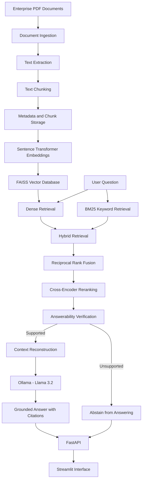

# Enterprise RAG AI Assistant

An advanced, end-to-end **Retrieval-Augmented Generation (RAG)** application designed to answer enterprise questions using internal company policy documents.

The system combines **Dense Vector Search, BM25 Keyword Retrieval, Reciprocal Rank Fusion (RRF), Cross-Encoder Reranking, and Answerability Verification** to retrieve relevant evidence and generate context-grounded answers using a locally hosted Large Language Model.

Built with Python, FAISS, Sentence Transformers, FastAPI, Streamlit, and Ollama.

## Key Features

- **PDF Document Ingestion:** Extracts text and metadata from enterprise policy documents.
- **Intelligent Text Chunking:** Splits documents into overlapping chunks while preserving source metadata.
- **Semantic Search:** Generates embeddings using Sentence Transformers.
- **Vector Search:** Uses FAISS with normalized embeddings and inner-product similarity.
- **BM25 Keyword Retrieval:** Captures exact keyword and terminology matches.
- **Hybrid Retrieval:** Combines semantic and keyword search using Reciprocal Rank Fusion (RRF).
- **Cross-Encoder Reranking:** Reorders retrieved passages based on relevance to the original question.
- **Answerability Verification:** Checks whether retrieved evidence sufficiently supports the requested answer.
- **Hallucination Reduction:** Rejects unsupported questions instead of generating answers without evidence.
- **Context Reconstruction:** Combines overlapping chunks from the same source page to provide more complete context.
- **Source Citations:** Returns document names and page references for supported answers.
- **Local LLM Inference:** Uses Llama 3.2 3B through Ollama.
- **FastAPI Backend:** Exposes the RAG pipeline through REST endpoints.
- **Streamlit Frontend:** Provides an interactive question-answering interface.
- **Automated Testing:** Includes API tests and a 14-case RAG regression suite.
- **Multi-Dataset Support:** Supports independent Northstar Solutions and Apex Technologies document collections.

## System Architecture



## Retrieval Pipeline

The system follows a multi-stage retrieval architecture.

1. **Dense Retrieval:** Retrieves semantically similar document chunks using FAISS and Sentence Transformer embeddings.
2. **BM25 Retrieval:** Finds keyword-relevant passages using lexical matching.
3. **Hybrid Fusion:** Combines both retrieval rankings using Reciprocal Rank Fusion.
4. **Reranking:** Uses a Cross-Encoder to evaluate question-passage relevance and improve ranking quality.
5. **Answerability Verification:** Checks whether retrieved evidence supports the requested information.
6. **Context Reconstruction:** Merges relevant overlapping chunks from the same source document page.
7. **Answer Generation:** Uses Llama 3.2 through Ollama to generate an answer based on verified context.
8. **Citation Generation:** Attaches source document and page information programmatically.

Unsupported questions are rejected rather than answered using unsupported assumptions.

## Technology Stack

| Component | Technology |
|---|---|
| Programming Language | Python 3.12 |
| Embedding Model | all-MiniLM-L6-v2 |
| Vector Database | FAISS |
| Keyword Retrieval | BM25 |
| Retrieval Strategy | Hybrid Search + RRF |
| Reranking Model | cross-encoder/ms-marco-MiniLM-L-6-v2 |
| Large Language Model | Llama 3.2 3B |
| LLM Runtime | Ollama |
| Backend | FastAPI |
| Frontend | Streamlit |
| PDF Processing | PyPDF |
| Testing | Pytest |
| Data Processing | NumPy |

## Supported Enterprise Datasets

The application supports two independent fictional enterprise document collections.

### 1. Northstar Solutions

Contains company policies covering:

- Employee HR policies
- Information security
- Leave and attendance

### 2. Apex Technologies

Contains company policies covering:

- Compensation and employee benefits
- IT security
- Workplace policies
- Business travel and expense reimbursement

Each dataset has its own FAISS index and chunk metadata, allowing independent retrieval and evaluation.

## Project Structure

```text
Enterprise RAG AI Assistant/
│
├── api/
│   └── main.py
│
├── app/
│   └── streamlit_app.py
│
├── data/
│   ├── raw/
│   ├── processed/
│   └── benchmark_v2/
│       ├── raw/
│       └── processed/
│           ├── apex_faiss.index
│           └── apex_chunks_metadata.json
│
├── evaluation/
│   ├── benchmark_v2/
│   ├── retrieval_benchmark.json
│   └── test_answerability.py
│
├── src/
│   ├── document_ingestion.py
│   ├── text_chunking.py
│   ├── generate_embeddings.py
│   ├── build_vector_database.py
│   ├── dense_retriever.py
│   ├── bm25_retriever.py
│   ├── hybrid_retriever.py
│   ├── reranker.py
│   ├── answerability_checker.py
│   ├── rag_pipeline.py
│   └── create_benchmark_v2_documents.py
│
├── tests/
│   ├── test_api.py
│   └── test_rag_regression.py
│
├── vectorstore/
│   ├── enterprise_faiss.index
│   └── chunks_metadata.json
│
├── requirements.txt
├── .gitignore
└── README.md
```

## Installation and Setup

### 1. Clone the repository

```bash
git clone YOUR_GITHUB_REPOSITORY_URL
cd Enterprise-RAG-AI-Assistant
```

### 2. Create a virtual environment

```bash
python -m venv .venv
```

Activate on Windows:

```powershell
.venv\Scripts\Activate.ps1
```

### 3. Install dependencies

```bash
pip install -r requirements.txt
```

### 4. Install Ollama

Install Ollama from:

https://ollama.com/

Download the model:

```bash
ollama pull llama3.2:3b
```

Ensure Ollama is running locally.

The application uses:

```text
http://localhost:11434
```

### 5. Prepare the vector databases

The repository includes prebuilt Northstar and Apex FAISS indexes and their corresponding metadata files.

If rebuilding the databases, use the document ingestion, chunking, embedding, and vector database construction scripts in `src/`.

The Apex benchmark documents can be regenerated using:

```bash
python src/create_benchmark_v2_documents.py
```

## Running the Application

### 1. Start the FastAPI backend

```bash
uvicorn api.main:app --reload
```

API documentation:

http://127.0.0.1:8000/docs

### 2. Start the Streamlit frontend

Open a second terminal:

```bash
streamlit run app/streamlit_app.py
```

Open the application:

http://localhost:8501

## Testing

### API Tests

```bash
python -m pytest tests/test_api.py -v
```

Previously verified API test suite: **5 passing tests**.

### RAG Regression Tests

```bash
python -m pytest tests/test_rag_regression.py -v
```

Latest verified result:

**14 passed in 203.39 seconds.**

The regression suite covers:

- Supported questions from both enterprise datasets
- Exact policy information retrieval
- Numerical and time-based answers
- Security and workplace policy questions
- Unsupported questions
- Correct source attribution
- Rejection of unsupported maternity leave information

## Evaluation and Retrieval Quality

The project includes a retrieval benchmark and answerability evaluation framework.

### Retrieval Benchmark Results

| Metric | Result |
|---|---:|
| Mean Precision@5 | 0.20 |
| Recall@5 | 1.00 |
| MRR@5 | 1.00 |
| Hit Rate@5 | 1.00 |
| Unsupported Rejection Rate | 1.00 |

These results are from the initial Northstar retrieval benchmark containing 11 answerable questions and one unanswerable question.

### Cross-Encoder Evaluation

The Cross-Encoder was tested on the Apex dataset.

It correctly ranked the relevant passage first for the tested questions covering:

- Annual performance bonus
- Cybersecurity incident reporting
- Internet reimbursement

### Answerability Verification

An additional synthetic evaluation containing 110 questions previously achieved:

- True Positives: 72
- True Negatives: 38
- False Positives: 0
- False Negatives: 0

These are results on a small, constructed in-domain evaluation set, not a guarantee of production accuracy or generalization to unseen enterprise documents.

## API Capabilities

The FastAPI backend exposes the RAG application through REST endpoints.

Interactive API documentation is available at:

http://127.0.0.1:8000/docs

The application accepts user questions and returns generated answers, support status, and source information through the API.

## Limitations and Future Improvements

- Expand evaluation using larger, independently curated datasets.
- Add document-level access control and authentication.
- Introduce more advanced chunking strategies.
- Evaluate additional embedding and reranking models.
- Add observability, structured logging, and latency monitoring.
- Implement Docker-based deployment.
- Deploy the application with persistent vector storage.
- Improve scalability for larger enterprise document collections.

## Cost and Deployment

The project uses open-source models and locally hosted inference through Ollama. It does not require a paid LLM API.

The current implementation is designed for local execution. Public deployment requires a suitable environment for hosting the API, frontend, model inference, and vector database.

## Author

Developed as an end-to-end AI engineering portfolio project demonstrating enterprise RAG architecture, information retrieval, local LLM integration, evaluation, and API development.
